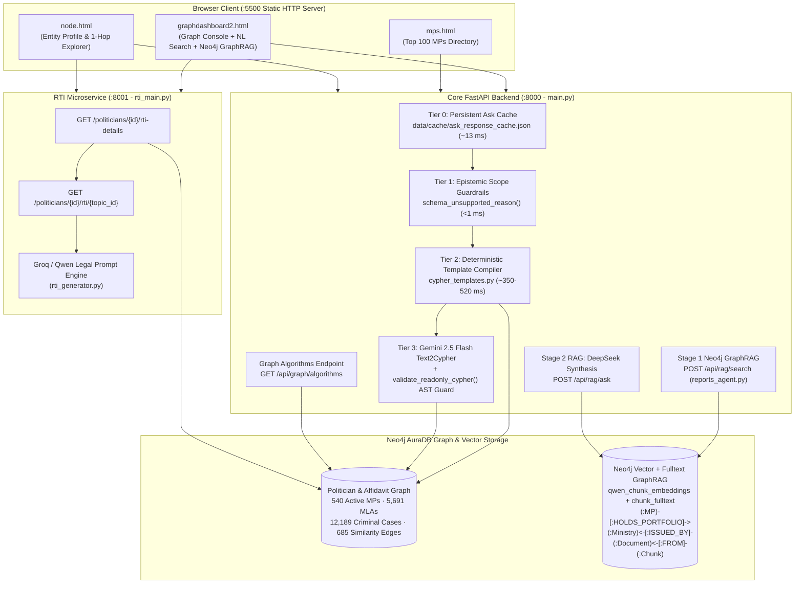
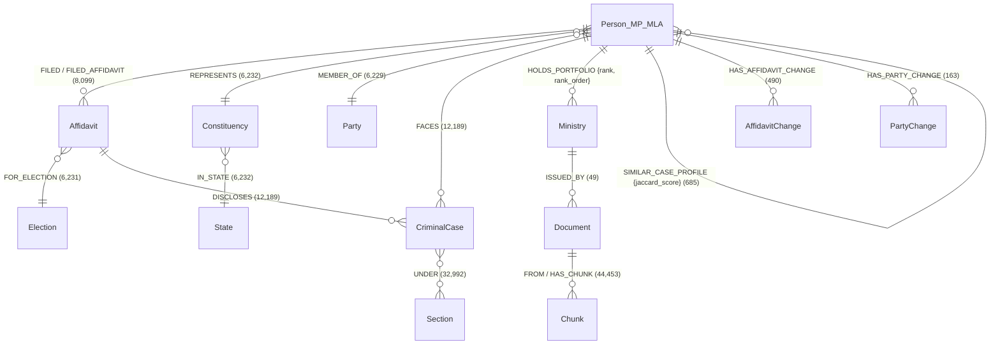

# Bharat Praman — Product & Engineering Guide

> [!NOTE]
> **About This Document:** This guide is written for two audiences:
> - **Part I — For Prospective Users (Citizens, Journalists, Civic Researchers & Evaluators):** What Bharat Praman is, what problems it solves, and how to use its four core workflows.
> - **Part II — For Engineers (Backend, Data, AI & Frontend Developers):** How the system is architected across Neo4j AuraDB, the 4-tier Hybrid Text-to-Cypher engine, the Neo4j Vector + GraphRAG Ministry pipeline, Graph Algorithms (GDS), and the Autonomous RTI microservice.

---

# Part I: For Prospective Users — What is Bharat Praman & Why Is It Useful?

## 1. The Problem We Solve
In India, public accountability data is legally public—but practically unreachable for an ordinary citizen, voter, or investigative journalist:
1. **Fragmented Silos:** Candidate wealth, liabilities, and pending criminal charges are locked inside thousands of individual election affidavits (MyNeta / Election Commission of India), parliamentary biographies (Digital Sansad), and Indian Penal Code (IPC) / Bharatiya Nyaya Sanhita (BNS) legal tables.
2. **No Cross-Linking:** Answering a connected question like *"Which MPs from Uttar Pradesh have both criminal cases and declared assets above ₹30 Crore?"* or *"Which re-elected MPs saw the largest asset jump between elections?"* requires hours of manual spreadsheet joining.
3. **Opaque Government Reports:** Union Ministry Annual Reports and Budget documents span 49+ PDFs and 44,453 indexed passages; standard AI chatbots hallucinate numbers without showing the exact government page or linking the report back to the responsible Cabinet Minister.
4. **High Friction to Action:** Even when a citizen discovers a discrepancy, drafting a legally valid **Right to Information (RTI) Act, 2005** application addressed to the right Public Information Officer (PIO) requires legal know-how.

---

## 2. What Bharat Praman Is
**Bharat Praman** (*"Proof of India"*) is an **Evidentiary Civic Intelligence Platform** that connects **`540` active 18th Lok Sabha MPs** (plus `2,481` `:HistoricalMP` records and `5,691` State Assembly MLAs), **8,099 election affidavits**, **12,189 declared criminal cases**, **639 IPC/BNS sections**, **56 Union Ministries**, and **49 official Ministry Annual Report PDFs (`44,453` Neo4j vector-indexed chunks)** into a unified Neo4j knowledge graph—paired with **Graph Algorithms** and an **Autonomous RTI Legal Drafter**.

````carousel

<!-- slide -->

<!-- slide -->

````

---

## 3. Four Ways Bharat Praman Is Useful in Practice

| Workflow | What You Can Do | Real Example Query / Action | What You Get Back |
| :--- | :--- | :--- | :--- |
| **1. Ask the Politician & Affidavit Graph** ([graphdashboard2.html](file:///C:/Users/aarya/OneDrive/Desktop/Bharat%20Praman/Bharat-Praman/graphdashboard2.html)) | Ask plain-English 1-hop to 4-hop questions or run Graph Algorithms (case similarity & party-switching PageRank). | *"Who is the Minister of Defence?"*, *"Which BJP MPs from Uttar Pradesh have criminal cases?"*, or *"Which MPs have the most similar criminal case profiles?"* | Verified data table + interactive Neo4j graph + exact Cypher query used (`~13 ms` cached / `~450 ms` live). |
| **2. Browse the Top 100 MPs & 360° Profiles** ([mps.html](file:///C:/Users/aarya/OneDrive/Desktop/Bharat%20Praman/Bharat-Praman/mps.html) & [node.html](file:///C:/Users/aarya/OneDrive/Desktop/Bharat%20Praman/Bharat-Praman/node.html)) | Rank MPs by declared assets (`₹ Cr/Lakh`), criminal cases, or Lok Sabha terms; filter by party or state; inspect any MP's full dossier. | Click **Chandra Sekhar Pemmasani**, **Rajnath Singh**, or **Supriya Sule** in the Top 100 directory. | Full profile showing net worth, liabilities, education, constituency, Cabinet/MoS ministry portfolios, and 1-hop graph links. |
| **3. True Neo4j GraphRAG over Ministry PDFs** ([graphdashboard2.html](file:///C:/Users/aarya/OneDrive/Desktop/Bharat%20Praman/Bharat-Praman/graphdashboard2.html)) | Search across 49 Union Ministry Annual Reports (`44,453` chunks in Neo4j Vector Index `qwen_chunk_embeddings`) linked directly to `:Ministry` and `:MP` nodes. | *"What are the key highlights of Ministry of Defence annual report?"* | Ranked evidence excerpts with **direct `#page=N` PDF links**, clickable **Cabinet Minister / MoS portfolio links** (`Rajnath Singh`, `Sanjay Seth`), and an opt-in **DeepSeek Summary** button. |
| **4. Generate a Ready-to-File RTI Application** ([rti.html](file:///C:/Users/aarya/OneDrive/Desktop/Bharat%20Praman/Bharat-Praman/rti.html) at `:8001/rti-page`) | Convert a politician's affidavit anomaly, pending case, or constituency fund question into a formal statutory RTI request. | Select an MP -> choose topic (*Affidavit Discrepancy*, *Criminal Case Status*, *Constituency Works*) -> click **Generate RTI**. | A legally formatted **Section 6(1) RTI Act 2005** draft with the exact PIO authority, statutory 30-day deadline clause, and ₹10 fee rules. |

---

# Part II: For Engineers — System Architecture & Technical Design

## 1. High-Level Service Topology

Bharat Praman runs as a **three-service stack** orchestrated by [start_all.py](file:///C:/Users/aarya/OneDrive/Desktop/Bharat%20Praman/Bharat-Praman/start_all.py):



---

## 2. Neo4j Property & Vector Graph Schema



### Core Node Labels & Key Properties
- **`MP` (`540` active 18th Lok Sabha MPs) / `HistoricalMP` (`2,481` historical records) / `MLA` (`5,691`):**
  - Identifiers: `entity_id` (`sansad_mp_*`, `myneta_*`), `name`, `myneta_name`, `person_key`
  - Financials: `total_assets` (INR float/int), `liabilities` (INR float/int)
  - Legal: `criminal_case_count`, `serious_criminal_cases`, `convicted_cases`
  - Demographics & Career: `party_name`, `state`, `age`, `gender`, `education`, `profession`, `terms`
- **`Ministry` (`56`), `Document` (`49`), & `Chunk` (`44,453`):**
  - Linked via `(:MP)-[:HOLDS_PORTFOLIO {rank: 'Cabinet Minister' | 'Minister of State', rank_order: 1 | 2}]->(:Ministry)<-[:ISSUED_BY]-(:Document)<-[:FROM]-(:Chunk)`.
  - `:Chunk` nodes are indexed by Neo4j Vector Index `qwen_chunk_embeddings` and Neo4j Fulltext Index `chunk_fulltext`.
- **Graph Analytics & Longitudinal Nodes:**
  - `SIMILAR_CASE_PROFILE` (`685` edges): `jaccard_score`, `shared_count`, `shared_sections`
  - `Party` analytics properties: `switcher_pagerank`, `in_defections`, `out_defections`, `net_defection_gain`, `switcher_community`
  - `AffidavitChange` (`490`) & `PartyChange` (`163`): Cross-election wealth and party-switch deltas.

---

## 3. The 4-Tier Hybrid Text-to-Cypher Engine (`POST /api/ask`)

[main.py](file:///C:/Users/aarya/OneDrive/Desktop/Bharat%20Praman/Bharat-Praman/main.py) and [cypher_templates.py](file:///C:/Users/aarya/OneDrive/Desktop/Bharat%20Praman/Bharat-Praman/cypher_templates.py) implement a 4-tier cascade:

1. **Tier 0 — Persistent Disk + RAM Response Cache ([main.py](file:///C:/Users/aarya/OneDrive/Desktop/Bharat%20Praman/Bharat-Praman/main.py#L225-L269)):**
   - Normalized question lookup backed by [ask_response_cache.json](file:///C:/Users/aarya/OneDrive/Desktop/Bharat%20Praman/Bharat-Praman/data/cache/ask_response_cache.json) (`p50 = 13.17 ms`, `p95 = 33.42 ms`).
2. **Tier 1 — Epistemic Scope Guardrails (`schema_unsupported_reason`):**
   - `<1 ms` refusal for out-of-schema traps (roll-call bill votes, election vote margins, spouse/family, weather/predictions).
3. **Tier 2 — Deterministic Cypher Template Compiler ([cypher_templates.py](file:///C:/Users/aarya/OneDrive/Desktop/Bharat%20Praman/Bharat-Praman/cypher_templates.py)):**
   - Compiles 1-hop to 4-hop queries (State × Party × Criminal Cases, Zero-Case clean filters, Asset/Liability thresholds, IPC sections, Cabinet/MoS Ministries, Demographics, Cross-Election changes, and Graph Algorithms) directly into parameterized Cypher (`0` LLM tokens).
4. **Tier 3 — Gemini `2.5-flash` Fallback + Read-Only AST Validator (`validate_readonly_cypher`):**
   - Enforces `READ_ACCESS` transactions, whitelisted labels/relationships/properties, and blocks `CREATE/MERGE/DELETE/SET/CALL/LOAD CSV`.

---

## 4. Two-Stage Neo4j GraphRAG Pipeline ([reports_agent.py](file:///C:/Users/aarya/OneDrive/Desktop/Bharat%20Praman/Bharat-Praman/reports_agent.py))

1. **Stage 1 — Neo4j Vector + Fulltext Retrieval & Portfolio Join (`POST /api/rag/search`):**
   - Executes Reciprocal Rank Fusion (RRF) over Neo4j's `qwen_chunk_embeddings` vector index (`CALL db.index.vector.queryNodes`) and `chunk_fulltext` Lucene index (`CALL db.index.fulltext.queryNodes`) with scheme-acronym and financial-table boosting.
   - Traverses `(:Chunk)-[:FROM]->(:Document)-[:ISSUED_BY]->(:Ministry)<-[:HOLDS_PORTFOLIO]-(:MP)` to attach the responsible Cabinet Minister & MoS MPs (`ministers`) plus direct `#page=N` PDF links to every hit.
2. **Stage 2 — Opt-In DeepSeek Synthesis (`POST /api/rag/ask`):**
   - Triggered on demand when the user clicks **"Generate AI Summary with DeepSeek"**, synthesizing an executive brief with strict unit preservation (`Rs. in Crore` / `BE` vs `RE`) and inline `[Source, Page N]` citations.

---

## 5. Developer Quick-Start & API Reference

### Running the Full Stack Locally
```powershell
# Start all 3 servers (:5500 Frontend, :8000 Core Graph/GDS/GraphRAG API, :8001 RTI Service)
py -3.14 start_all.py
```

### Primary API Endpoints
| Port | Method & Path | Description |
| :---: | :--- | :--- |
| `:8000` | `POST /api/ask` | 4-tier natural-language to read-only Cypher query engine |
| `:8000` | `GET /api/graph/algorithms` | Graph Analytics: MP IPC Case-Profile Jaccard Similarity + Party-Switcher PageRank & Communities |
| `:8000` | `GET /api/mps/top?limit=100&sort_by=assets` | Top MPs ranked by `assets`, `cases`, `terms`, or `name` |
| `:8000` | `GET /api/nodes/{node_id}` | Full entity properties + 1-hop neighborhood graph for `node.html` |
| `:8000` | `POST /api/rag/search` | Neo4j Vector + Fulltext GraphRAG search with MP portfolio links & `#page=N` PDF links |
| `:8000` | `POST /api/rag/ask` | Opt-in DeepSeek narrative synthesis over retrieved Neo4j `:Chunk` nodes |
| `:8001` | `GET /rti-page` | Interactive RTI Act 2005 generator UI |
| `:8001` | `GET /politicians/{entity_id}/rti/{topic_id}` | Generates a statutory RTI application for a specific politician and topic |
