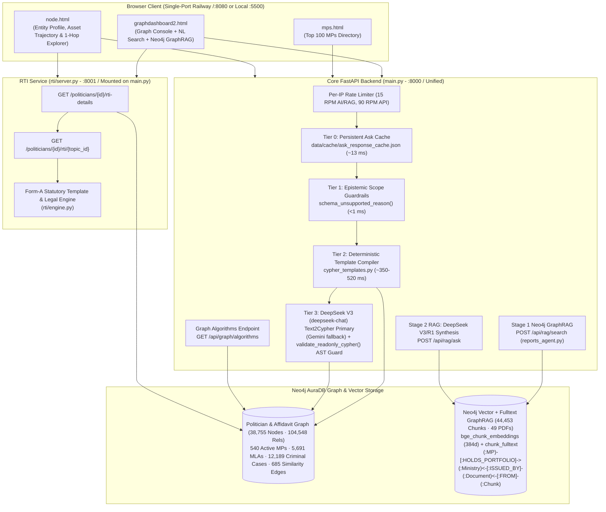
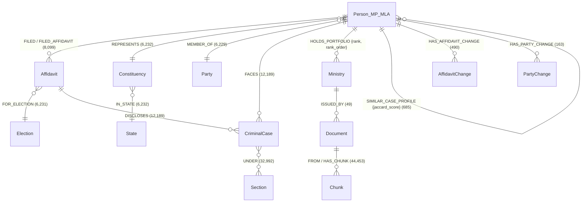

# Bharat Praman — Product & Engineering Guide

> [!NOTE]
> **About This Document:** This guide is written for two audiences:
> - **Part I — For Prospective Users (Citizens, Journalists, Civic Researchers & Evaluators):** What Bharat Praman is, what problems it solves, and how to use its four core workflows.
> - **Part II — For Engineers (Backend, Data, AI & Frontend Developers):** How the system is architected across Neo4j AuraDB, the 4-tier Hybrid Text-to-Cypher engine, the Neo4j Vector + GraphRAG Ministry pipeline, Graph Algorithms (GDS), and the Autonomous RTI microservice.

---

# Part I: For Prospective Users — What is Bharat Praman & Why Is It Useful?

## 1. The Problem We Solve
In India, public accountability data is legally public—but practically unreachable for an ordinary citizen, voter, or investigative journalist:
1. **Fragmented Silos:** Candidate wealth, liabilities, and pending criminal charges are locked inside thousands of individual election affidavits (MyNeta / Election Commission of India), parliamentary biographies (Digital Sansad), and Indian Penal Code (IPC) / Bharatiya Nyaya Sanhita (BNS) legal tables.
2. **No Cross-Linking:** Answering a connected question like *"Which MPs from Uttar Pradesh have both criminal cases and declared assets above ₹30 Crore?"* or *"Which re-elected MPs saw the largest asset jump between elections?"* requires hours of manual spreadsheet joining.
3. **Opaque Government Reports:** Union Ministry Annual Reports and Budget documents span 49+ PDFs and 44,453 indexed passages; standard AI chatbots hallucinate numbers without showing the exact government page or linking the report back to the responsible Cabinet Minister.
4. **High Friction to Action:** Even when a citizen discovers a discrepancy, drafting a legally valid **Right to Information (RTI) Act, 2005** application addressed to the right Public Information Officer (PIO) requires legal know-how.

---

## 2. What Bharat Praman Is
**Bharat Praman** (*"Proof of India"*) is an **Evidentiary Civic Intelligence Platform** deployed live at **https://bharat-praman-production.up.railway.app** that connects **38,755 graph nodes and 104,548 relationships**—including **`540` active 18th Lok Sabha MPs** (plus `2,481` `:HistoricalMP` records and `5,691` State Assembly MLAs), **8,099 election affidavits**, **12,189 declared criminal cases**, **639 IPC/BNS sections**, **56 Union Ministries**, and **49 official Ministry Annual Report & Union Budget PDFs (`44,453` Neo4j vector-indexed chunks)**—into a unified Neo4j knowledge graph paired with **Graph Algorithms** and an **Autonomous RTI Legal Drafter**.

````carousel

<!-- slide -->

<!-- slide -->

````

---

## 3. Four Ways Bharat Praman Is Useful in Practice

| Workflow | What You Can Do | Real Example Query / Action | What You Get Back |
| :--- | :--- | :--- | :--- |
| **1. Ask the Politician & Affidavit Graph** ([graphdashboard2.html](file:///C:/Users/aarya/OneDrive/Desktop/Bharat%20Praman/Bharat-Praman/graphdashboard2.html)) | Ask plain-English 1-hop to 4-hop questions or run Graph Algorithms (case similarity & party-switching PageRank). | *"Who is the Minister of Defence?"*, *"Which BJP MPs from Uttar Pradesh have criminal cases?"*, or *"Which MPs have the most similar criminal case profiles?"* | Verified data table + interactive Neo4j graph + exact Cypher query used (`~13 ms` cached / `~450 ms` live). |
| **2. Browse the Top 100 MPs & 360° Profiles** ([mps.html](file:///C:/Users/aarya/OneDrive/Desktop/Bharat%20Praman/Bharat-Praman/mps.html) & [node.html](file:///C:/Users/aarya/OneDrive/Desktop/Bharat%20Praman/Bharat-Praman/node.html)) | Rank MPs by declared assets (`₹ Cr/Lakh`), criminal cases, or Lok Sabha terms; filter by party or state; inspect any MP's full dossier. | Click **Chandra Sekhar Pemmasani**, **Rajnath Singh**, or **Supriya Sule** in the Top 100 directory. | Full profile showing net worth, liabilities, education, constituency, Cabinet/MoS ministry portfolios, and 1-hop graph links. |
| **3. True Neo4j GraphRAG over Ministry PDFs** ([graphdashboard2.html](file:///C:/Users/aarya/OneDrive/Desktop/Bharat%20Praman/Bharat-Praman/graphdashboard2.html)) | Search across 49 Union Ministry Annual Reports (`44,453` chunks in Neo4j Vector Index `bge_chunk_embeddings` via `BAAI/bge-small-en-v1.5`) linked directly to `:Ministry` and `:MP` nodes. | *"How much money was planned vs actually spent on PM-SHRI and Samagra Shiksha in 2023-24?"* | Ranked evidence excerpts with **direct `#page=N` PDF links**, clickable **Cabinet Minister / MoS portfolio links** (`Rajnath Singh`, `Sanjay Seth`), and **DeepSeek V3/R1 Synthesis**. |
| **4. Generate a Ready-to-File RTI Application** ([rti_page.html](file:///C:/Users/aarya/OneDrive/Desktop/Bharat%20Praman/Bharat-Praman/rti/rti_page.html) at `/rti/rti_page.html`) | Convert a politician's affidavit anomaly, pending case, or constituency fund question into a formal statutory RTI request. | Select an MP -> choose topic (*Affidavit Discrepancy*, *Criminal Case Status*, *Constituency Works*) -> click **Generate RTI**. | A legally formatted **Section 6(1) RTI Act 2005** draft with the exact PIO authority, statutory 30-day deadline clause, and ₹10 fee rules. |

---

# Part II: For Engineers — System Architecture & Technical Design

## 1. High-Level Service Topology

Bharat Praman runs both as a **unified single-port production container on Railway** (`uvicorn main:app`, mounting API + RTI routes + static UI) and as a **three-service local stack** orchestrated by [start_all.py](file:///C:/Users/aarya/OneDrive/Desktop/Bharat%20Praman/Bharat-Praman/start_all.py):



---

## 2. Neo4j Property & Vector Graph Schema



### Core Node Labels & Key Properties
- **`MP` (`540` active 18th Lok Sabha MPs) / `HistoricalMP` (`2,481` historical records) / `MLA` (`5,691`):**
  - Identifiers: `entity_id` (`sansad_mp_*`, `myneta_*`), `name`, `myneta_name`, `person_key`
  - Financials: `total_assets` (INR float/int), `liabilities` (INR float/int)
  - Legal: `criminal_case_count`, `serious_criminal_cases`, `convicted_cases`
  - Demographics & Career: `party_name`, `state`, `age`, `gender`, `education`, `profession`, `terms`
- **`Ministry` (`56`), `Document` (`49`), & `Chunk` (`44,453`):**
  - Linked via `(:MP)-[:HOLDS_PORTFOLIO {rank: 'Cabinet Minister' | 'Minister of State', rank_order: 1 | 2}]->(:Ministry)<-[:ISSUED_BY]-(:Document)<-[:FROM]-(:Chunk)`.
  - `:Chunk` nodes are indexed by Neo4j Vector Index `bge_chunk_embeddings` (384-dim `BAAI/bge-small-en-v1.5`, ~130 MB model, `0.02s` load on Railway, ~350–450 MB RAM; migrated from 2.4 GB `Qwen3-Embedding-0.6B` to cut cold-start from 204s to <1s) and Neo4j Fulltext Index `chunk_fulltext`.
- **Graph Analytics & Longitudinal Nodes:**
  - `SIMILAR_CASE_PROFILE` (`685` edges): `jaccard_score`, `shared_count`, `shared_sections`
  - `Party` analytics properties: `switcher_pagerank`, `in_defections`, `out_defections`, `net_defection_gain`, `switcher_community`
  - `AffidavitChange` (`490`) & `PartyChange` (`163`): Cross-election wealth and party-switch deltas.

---

## 3. The 4-Tier Hybrid Text-to-Cypher Engine (`POST /api/ask`)

[main.py](file:///C:/Users/aarya/OneDrive/Desktop/Bharat%20Praman/Bharat-Praman/main.py) and [cypher_templates.py](file:///C:/Users/aarya/OneDrive/Desktop/Bharat%20Praman/Bharat-Praman/cypher_templates.py) implement a 4-tier cascade:

1. **Tier 0 — Persistent Disk + RAM Response Cache ([main.py](file:///C:/Users/aarya/OneDrive/Desktop/Bharat%20Praman/Bharat-Praman/main.py#L225-L269)):**
   - Normalized question lookup backed by [ask_response_cache.json](file:///C:/Users/aarya/OneDrive/Desktop/Bharat%20Praman/Bharat-Praman/data/cache/ask_response_cache.json) (`p50 = 13.17 ms`, `p95 = 33.42 ms`).
2. **Tier 1 — Epistemic Scope Guardrails (`schema_unsupported_reason`):**
   - `<1 ms` refusal for out-of-schema traps (roll-call bill votes, election vote margins, spouse/family, weather/predictions, annual income).
3. **Tier 2 — Deterministic Cypher Template Compiler ([cypher_templates.py](file:///C:/Users/aarya/OneDrive/Desktop/Bharat%20Praman/Bharat-Praman/cypher_templates.py)):**
   - Compiles 1-hop to 4-hop queries (State × Party × Criminal Cases, Zero-Case clean filters, Asset/Liability thresholds, Year-Range filters like `after 1996`, Age thresholds like `older than 70`, IPC sections, Cabinet/MoS Ministries, Demographics, Cross-Election changes, and Graph Algorithms) directly into parameterized Cypher (`0` LLM tokens).
4. **Tier 3 — DeepSeek V3 (`deepseek-chat`) Primary + Gemini Fallback + Read-Only AST Validator (`validate_readonly_cypher`):**
   - Novel queries go to **`deepseek-chat`** first (JSON schema mode, with Gemini fallback), and every query passes `validate_readonly_cypher()` + Neo4j `READ_ACCESS` transactions blocking `CREATE/MERGE/DELETE/SET/CALL/LOAD CSV`.

---

## 4. Two-Stage Neo4j GraphRAG Pipeline ([reports_agent.py](file:///C:/Users/aarya/OneDrive/Desktop/Bharat%20Praman/Bharat-Praman/reports_agent.py))

1. **Stage 1 — Neo4j Vector + Fulltext Retrieval & Portfolio Join (`POST /api/rag/search`):**
   - Executes Reciprocal Rank Fusion (RRF) over Neo4j's **`bge_chunk_embeddings`** vector index (`CALL db.index.vector.queryNodes`) and `chunk_fulltext` Lucene index (`CALL db.index.fulltext.queryNodes`) with scheme-acronym boosting, financial-table unit boosting, Table-of-Contents down-ranking, and automatic explicit-year focusing (retrieves 10–14 chunks per query).
   - Traverses `(:Chunk)-[:FROM]->(:Document)-[:ISSUED_BY]->(:Ministry)<-[:HOLDS_PORTFOLIO]-(:MP)` to attach the responsible Cabinet Minister & MoS MPs (`ministers`) plus direct `#page=N` PDF links to every hit.
2. **Stage 2 — DeepSeek V3/R1 Synthesis (`POST /api/rag/ask`):**
   - Uses **`deepseek-chat` (V3)** for fast audit briefs / quick summaries and **`deepseek-reasoner` (R1)** for Deep Analysis (with `gemini-3.5-flash-lite` backup + LRU response cache returning repeat answers in `~0.88 ms`), enforcing strict unit preservation (`Rs. in Crore` / `BE` vs `RE`) and inline `[Source, Page N]` citations.

---

## 5. Developer Quick-Start & API Reference

### Running the Full Stack Locally
```powershell
# Start all 3 servers (:5500 Frontend, :8000 Core Graph/GDS/GraphRAG API, :8001 RTI Service)
py -3.14 start_all.py
```

### Primary API Endpoints
| Port | Method & Path | Description |
| :---: | :--- | :--- |
| `:8000` | `POST /api/ask` | 4-tier natural-language to read-only Cypher query engine (`DeepSeek V3` + templates) |
| `:8000` | `GET /api/graph/algorithms` | Graph Analytics: MP IPC Case-Profile Jaccard Similarity + Party-Switcher PageRank & Communities |
| `:8000` | `GET /api/mps/top?limit=100&sort_by=assets` | Top MPs ranked by `assets`, `cases`, `terms`, or `name` |
| `:8000` | `GET /api/nodes/{node_id}` | Full entity properties, multi-term asset trajectory, & 1-hop neighborhood graph for `node.html` |
| `:8000` | `POST /api/rag/search` | Neo4j Vector (`bge_chunk_embeddings`) + Fulltext GraphRAG search with MP portfolio & `#page=N` PDF links |
| `:8000` | `POST /api/rag/ask` | DeepSeek V3/R1 narrative synthesis over retrieved Neo4j `:Chunk` nodes |
| `:8001` / Unified | `GET /rti-page` | Interactive RTI Act 2005 generator UI |
| `:8001` / Unified | `GET /politicians/{entity_id}/rti/{topic_id}` | Generates a statutory RTI application for a specific politician and topic |

---

# Part III: Production Deployment, Security, Benchmarks & Viva Defense

## 1. Live Production Deployment (Railway)
- **Live Public URL:** **https://bharat-praman-production.up.railway.app** (Branch: `mp-history`, GitHub auto-deploy enabled).
- **Single-Port Unified Architecture ([Dockerfile](file:///C:/Users/aarya/OneDrive/Desktop/Bharat%20Praman/Bharat-Praman/Dockerfile) + [main.py](file:///C:/Users/aarya/OneDrive/Desktop/Bharat%20Praman/Bharat-Praman/main.py)):**
  - `main.py` mounts all RTI routes (`/rti/topics`, `/politicians/{id}/rti/...`, `/rti-page`) and whitelisted frontend HTML/JS/CSS assets on the single exposed `$PORT`, serving [graphdashboard2.html](file:///C:/Users/aarya/OneDrive/Desktop/Bharat%20Praman/Bharat-Praman/graphdashboard2.html) directly at `/`.
  - Installs **CPU-only PyTorch** (`--index-url https://download.pytorch.org/whl/cpu`) and pre-bakes `BAAI/bge-small-en-v1.5` (~130 MB) into the Docker image, bringing Railway runtime RAM down to **~350–450 MB** and model weight loading to **`< 0.1s`**.
  - Railway **App Sleeping (Serverless)** is enabled so idle containers pause cleanly inside the `$5/mo` Hobby tier.

## 2. Three-Layer Security & Cost Protection
1. **Per-IP Sliding-Window Rate Limiter ([main.py](file:///C:/Users/aarya/OneDrive/Desktop/Bharat%20Praman/Bharat-Praman/main.py#L120-L162)):** Caps AI/RAG endpoints (`/api/rag/ask`, `/api/rag/search`, `/api/ask`, `/api/budget/ask`) at **15 RPM/IP** and general `/api/*` endpoints at **90 RPM/IP** (honoring Railway's `X-Forwarded-For`), preventing bot/Denial-of-Wallet API drain.
2. **Cypher Static Firewall + Read-Only Transactions (`validate_readonly_cypher`):** Blocks `;`, comments, write/admin keywords (`CREATE`, `MERGE`, `SET`, `DELETE`, `DETACH`, `CALL`, `DROP`, `LOAD CSV`), enforces whitelisted schema identifiers, and runs Neo4j strictly under `default_access_mode=READ_ACCESS` (`session.execute_read`).
3. **Static File Whitelist & Secret Isolation:** Only `.html/.js/.css/image` extensions are served; `.env` is excluded via `.dockerignore` and blocked (`/.env` -> `404`, `/main.py` -> `404`).

## 3. Verified 60-Question Live Audit & Bugfix Benchmarks
Executed live against Neo4j AuraDB (`c1bf4c50` & `905d00a0`), `bge_chunk_embeddings`, and `deepseek-chat` with caches bypassed:

| Audit Category | Verified Result | Highlights & Post-Fix Verification |
| :--- | :---: | :--- |
| **MPs, Cabinet & Wealth (Q1–Q10)** | **10 / 10** *(post-fix)* | `who is mod` -> **Rajnath Singh** (386 ms); `Who are the 5 richest MPs in parliament?` fixed from gender misroute -> **Chandra Sekhar Pemmasani** (₹5,705.47 Cr, 5 rows); Gender queries (`75` female MPs) unaffected. |
| **GDS Graph Algorithms (Q11–Q15)** | **5 / 5** | 285–336 ms (`SIMILAR_CASE_PROFILE` Jaccard, Party-Switcher PageRank & Community clusters). |
| **Year-Range Filters (Q16–Q23)** | **8 / 8** | 477–596 ms (`inc mlas elected after 1996` -> 50 rows / `812` count; `bjp mps after 2014` -> 50 rows). |
| **Novel Cypher via DeepSeek (Q24–Q33)** | **10 / 10** *(post-fix)* | `Which MPs are older than 70?` fixed (`50` rows, ages `73`–`85`); `Rank states by total declared liabilities of their MPs` fixed via schema guidance (**36 rows**, #1 Andhra Pradesh ₹1,612.3 Cr / 24 MPs). |
| **PDF GraphRAG (`bge-small` + DeepSeek, Q34–Q48)** | **15 / 15** | Warm RAG ~3.0–4.7s, cached `0.88 ms`. Explicit-year lock + 10-chunk retrieval fixed **Q34** (PM-SHRI BE Rs 4,000 Cr vs RE Rs 2,800 Cr; Samagra Shiksha BE Rs 37,453.47 Cr vs RE Rs 33,000 Cr) and **Q46** (2025-26 Net Tax Revenue BE Rs 28,37,408.89 Cr). |
| **Honest Refusal Guardrails (Q49–Q54)** | **6 / 6** | 0–13 ms (`PM`, `CM`, `most corrupt`, `future winner`, `children abroad`, `annual income` all refused cleanly). |
| **Security & Injection Stress Tests (Q55–Q60)** | **6 / 6** | `DETACH DELETE`, `DROP INDEX`, `; DELETE ALL NODES`, prompt/password leak, `CALL dbms...`, `CREATE` all blocked; **0 secrets leaked; DB untouched (`38,755` nodes / `104,548` rels before & after)**. |

## 4. Revenue & Data-Flywheel Model ("Give-to-Get" RTI Graph)
1. **Free Tier (Citizen Acquisition & Crowdsourcing):**
   - **Self-Service RTI (₹0 platform cost):** Unlimited Form-A draft generation with CPIO routing; citizens file for ₹10 on `rtionline.gov.in`.
   - **Curated Sponsored Public-Interest RTIs (₹100/RTI cost):** Strictly vetted/upvoted missing disclosures funded by Bharat Praman to permanently enrich the graph.
   - **"Give-to-Get" RTI Upload (₹0 CAC):** Users upload received RTI replies → get a free GraphRAG cross-analysis against Union Budgets & past RTIs while redacted records expand our proprietary **RTI Knowledge Graph**.
2. **Paid B2B Intelligence (High-Margin Verification):**
   - **AI-First, Lawyer-Verified Dossiers (₹1,500–₹5,000/dossier & ₹15,000–₹50,000/mo B2B subscriptions):** Bharat Praman + DeepSeek generates ~90% of the cross-analysis (~₹2 compute); empaneled lawyers perform a 15-minute legal proofread & **Section 8(1) RTI Act** redaction (stripping PII/security exemptions so the platform stays defamation-safe) for newsrooms, investigative journalists, think tanks, law firms, and ESG teams.

## 5. Top 8 Likely Viva / Judge Questions & Crisp Answers
1. **Why Neo4j instead of standard ChromaDB / FAISS Vector RAG?**  
   *Vector-only RAG cannot traverse from a Defence budget PDF paragraph to the Cabinet Minister's affidavit wealth and criminal cases; Neo4j links `(:Chunk)-[:FROM]->(:Document)-[:ISSUED_BY]->(:Ministry)<-[:HOLDS_PORTFOLIO]-(:MP)` in one query.*
2. **Why switch from `Qwen3-Embedding-0.6B` to `BAAI/bge-small-en-v1.5`?**  
   *`Qwen3-0.6B` (2.4 GB float32) caused a 204s cold-start and ~2.5 GB RAM bloat on CPU; `bge-small` (130 MB, 384-dim) loads in `<0.1s` in Docker, embeds ~6× faster (~314 ms warm), fits on Railway's ~$1–4/mo Hobby footprint, and preserves accuracy via Hybrid RRF (Vector + Fulltext).*
3. **Why DeepSeek V3/R1 over Gemini Free Tier for production?**  
   *DeepSeek handles multi-table BE/RE budget math cleanly (`deepseek-chat` + `deepseek-reasoner`), uses a prepaid hard-cap wallet (zero runaway credit card bills), and avoids Gemini Free Tier `429` throttling under judge/public traffic.*
4. **How do you prevent hallucinations on political/financial claims?**  
   *Four defenses: (1) deterministic Cypher templates for core metrics, (2) explicit `<1ms` epistemic refusals (`schema_unsupported_reason`), (3) strict RAG prompting requiring verbatim `Rs. Crore` units & `[PDF, Page N]` citations, and (4) explicit non-disclosure statements when retrieved pages lack a figure.*
5. **How do you stop prompt injection or someone wiping your Neo4j database?**  
   *Even if an LLM is jailbroken, `validate_readonly_cypher()` rejects comments/semicolons/write clauses (`DELETE/CREATE/SET/CALL`) via AST regex, Neo4j executes strictly in `READ_ACCESS` mode, and secrets never enter LLM prompts (6/6 injection tests verified).*
6. **How did you fix the "Defence Minister" & `1996` MLA multi-hop issues?**  
   *Purged duplicate unlinked `:Person` stubs, linked active 18th Lok Sabha `:Person:MP` cabinet nodes to `:Ministry` with `rank_order`, added `politicians_by_year_filter` for inequality year queries, and tightened word-boundary matching (`\bmen\b` vs `"parliament"`).*
7. **How is your `Node.js`/UI API protected against spam bots?**  
   *Sliding-window per-IP rate limiting middleware (`15 RPM` on AI/RAG endpoints, `90 RPM` on general `/api/*`), response caching (`0.88 ms` RAG / `13 ms` Cypher), and Railway App Sleeping.*
8. **What prevents competitors from copying your RTI data once you launch?**  
   *The "Give-to-Get" flywheel crowdsources scattered physical/PDF RTI replies at ₹0 CAC into a linked, lawyer-verified Neo4j RTI-to-Budget graph that didn't exist before—compounding into an institutional intelligence moat.*
