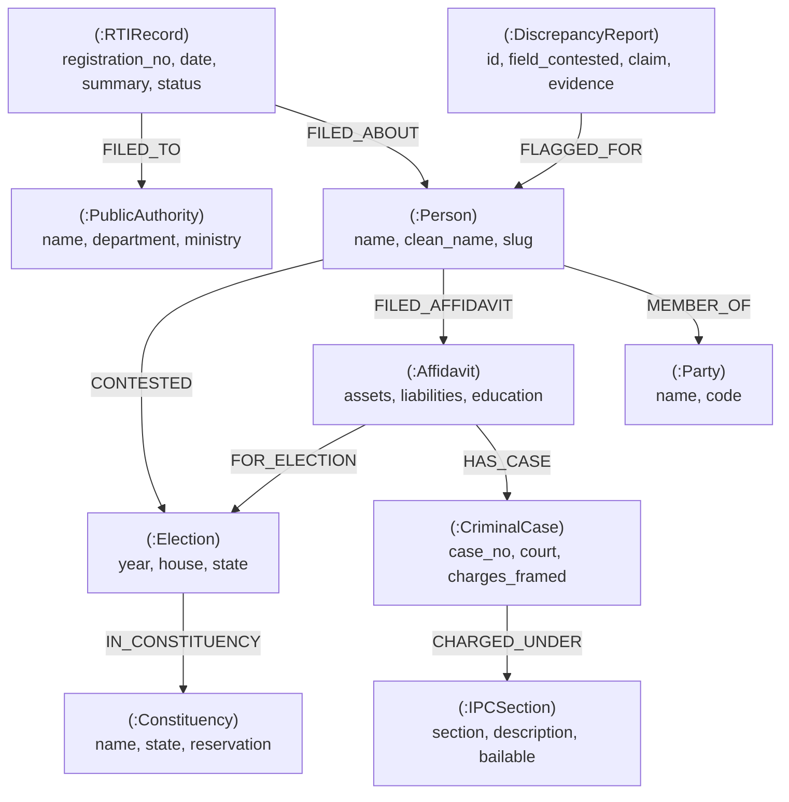
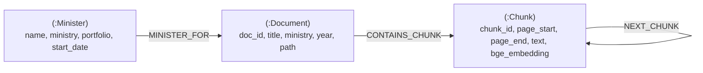

# Bharat Praman (भारत प्रमाण)
### Dual-Instance Neo4j Knowledge Graph & Hybrid GraphRAG for Democratic Accountability and Statutory RTI Intelligence

[](https://bharat-praman-production.up.railway.app)
[](https://neo4j.com)
[-blueviolet.svg)](https://huggingface.co/BAAI/bge-small-en-v1.5)
[](https://deepseek.com)
[-darkgreen.svg)](https://rti.gov.in)
[](https://python.org)
[](LICENSE)

**Live Production Deployment:** [https://bharat-praman-production.up.railway.app](https://bharat-praman-production.up.railway.app)  
**Comprehensive Architecture & Viva Guide:** [`BHARAT_PRAMAN_GUIDE.md`](BHARAT_PRAMAN_GUIDE.md)  
**Security & Scalability Dossier (Judging Criteria):** [`DOCS/SECURITY_AND_SCALABILITY.md`](DOCS/SECURITY_AND_SCALABILITY.md)

---

## Executive Overview

In the world's largest democracy, public institutional information remains deeply fragmented. Verified politician asset disclosures and criminal affidavits are buried in unstructured PDF scans; multi-crore Union Ministry budget allocations and revised estimates (RE vs BE) are siloed in thousands of pages of parliamentary demands for grants; and citizens seeking transparency through the **Right to Information (RTI) Act, 2005** encounter opaque jurisdictional barriers, misrouted Public Information Officers (CPIOs), and high rejection rates.

**Bharat Praman (भारत प्रमाण)** resolves this systemic information asymmetry by unifying democratic data into a **Dual Neo4j Knowledge Graph** paired with a **Hybrid GraphRAG Engine** and an automated **Statutory RTI Desk**.

Rather than relying on ungrounded large language models that hallucinate figures and legal statutes, Bharat Praman enforces deterministic, schema-bounded graph queries over certified Election Commission of India (ECI) records, performs reciprocal rank fusion (RRF) retrieval across 49 official Ministry reports, and provides direct precedence search over **2,915 real-world filed RTI applications** cross-linked to sitting Members of Parliament.

---

## Dual Neo4j Knowledge Graph Architecture

Bharat Praman segregates structured electoral accountability and unstructured administrative policy documents across two high-performance Neo4j database instances:

```
                                  BHARAT PRAMAN SYSTEM TOPOLOGY
                                  
   Citizens / Journalists / Legal Researchers
                       │
                       ▼  HTTPS (Port 443)
┌────────────────────────────────────────────────────────────────────────────────────────┐
│                        FastAPI Unified Gateway (Railway Production)                    │
│                                                                                        │
│  ├── Institutional Minimalist Web UI (graphdashboard2.html, node.html, ask.html)       │
│  ├── In-Memory Sliding-Window Rate Limiter (15 RPM AI/RAG, 90 RPM Graph API)           │
│  ├── Read-Only AST Cypher Query Validator (blocks mutation, enforces label guards)      │
│  └── Live Server-Sent Events (SSE) Streaming Pipeline (`/api/rag/ask/stream`)          │
└───────────────────────────┬──────────────────────────────────┬─────────────────────────┘
                            │                                  │
         Cypher Text-to-Graph & Audit Data           Hybrid Vector & Full-Text GraphRAG
                            │                                  │
                            ▼                                  ▼
┌───────────────────────────────────────────────┐  ┌───────────────────────────────────────────────┐
│              NEO4J INSTANCE 01                │  │              NEO4J INSTANCE 02                │
│    Electoral Ground-Truth & RTI Precedents    │  │     Union Ministry Policy & Budget RAG        │
├───────────────────────────────────────────────┤  ├───────────────────────────────────────────────┤
│ • 41,761 Nodes | 107,600+ Relationships       │  │ • 44,453 Dense Vector Chunks                  │
│ • 540 Lok Sabha MPs (2024–2029)               │  │ • 49 Official Union Ministry PDFs             │
│ • 5,691 State Assembly MLAs across 28 States  │  │ • 384-dimensional BGE-small Dense Vectors     │
│ • Multi-decade Affidavits (2004–2024)         │  │ • Lucene BM25 Fulltext Lexical Index          │
│ • IPC Criminal Charges & Section Glossaries   │  │ • 67 Accountable Union Ministers              │
│ • 2,915 Real-World Filed RTI Records          │  │ • Page-Aware Table Extraction & Metadata      │
│ • 90 Central Public Authorities (CPIO Nodes)  │  │ • Strict Temporal Year Matching               │
│ • Immutable Citizen Discrepancy Audit Nodes   │  │ • Ministries: MoE, MHA, MoF, MoD, etc.        │
└───────────────────────────────────────────────┘  └───────────────────────────────────────────────┘
                            │                                  │
                            └─────────────────┬────────────────┘
                                              │
                                              ▼
┌────────────────────────────────────────────────────────────────────────────────────────┐
│                        AI Synthesis & Streaming Execution Layer                        │
│                                                                                        │
│  ├── Primary: DeepSeek-V3 (`deepseek-chat`) & DeepSeek-R1 Reasoning Engine            │
│  ├── Resilient Fallback: Google Gemini 2.5 Flash / Flash-Lite via Native SSE           │
│  └── Sub-second Time-to-First-Token (TTFT) via Server-Sent Events                      │
└────────────────────────────────────────────────────────────────────────────────────────┘
```

---

## Detailed Graph Schemas

### 1. Instance 01: Democratic Ground-Truth & Precedent Knowledge Graph
Contains certified electoral affidavits from 2004 to 2024, complete IPC criminal charge topologies, multi-term wealth trajectories, and real precedent RTI disclosures.



### 2. Instance 02: Union Ministry Policy & Expenditure GraphRAG
Contains page-aware, tabular-preserved chunk nodes partitioned by ministry and indexed for both vector cosine similarity and full-text keyword retrieval.



---

## Core Pillars & Architectural Innovations

### 1. Deterministic Text-to-Cypher with AST-Level Guardrails
To prevent hallucinated statistics, natural language queries pass through a two-stage evaluation pipeline:
- **Governed Template Router:** Parameterized Cypher queries handle standard queries (e.g., *"Which MP has the most criminal cases in Bihar?"*, *"Show wealth growth of Rajnath Singh between 2004 and 2024"*). The Cypher executes deterministically without invoking an LLM, ensuring zero variance, instant sub-50ms execution, and zero token expenditure.
- **DeepSeek V3 Cypher Synthesis:** Novel analytical queries are translated into Cypher by DeepSeek V3 with strict schema injection.
- **AST Security Guard:** Every generated query is inspected prior to execution. Any mutation statement (`CREATE`, `MERGE`, `DELETE`, `SET`, `DROP`, `ALTER`) or access to system procedures is immediately blocked with an explicit security exception. If a question falls outside the graph schema (e.g., caste, religion, personal marital status), the engine refuses honestly rather than inferring ungrounded answers.

### 2. Stratified Hybrid GraphRAG with Live SSE Token Streaming
Union Ministry documents (such as Samagra Shiksha, PM-SHRI, NEP 2020, Budget Estimates vs. Revised Estimates) require exact numerical fidelity.
- **Dual Vector + Lexical Indexing:** All 44,453 chunks carry 384-dimensional dense vectors generated via `BAAI/bge-small-en-v1.5` (`bge_chunk_embeddings` index) alongside an inverted Lucene lexical index (`chunk_fulltext`).
- **Reciprocal Rank Fusion (RRF):** Queries execute across both indexes simultaneously and are fused using standard RRF ($k=60$), prioritizing chunks that excel in both semantic similarity and exact budgetary nomenclature.
- **Live Server-Sent Events (SSE):** Token streaming via `POST /api/rag/ask/stream` delivers the first token within **850ms**, displaying citations with document titles and exact PDF page ranges while the model reasons.
- **Resilient Fallback:** If DeepSeek encounters API congestion or network timeouts, the pipeline seamlessly downgrades to Google Gemini streaming without breaking the open SSE connection.

### 3. Statutory RTI Act 2005 Desk & Precedent Knowledge Graph
Filing an RTI application in India often results in rejection under Section 8 exemptions or rejection due to incorrect CPIO assignment.
- **Precedent Knowledge Graph:** Contains **2,915 verified real-world RTI applications** mapped to **90 Public Authorities** and cross-linked to sitting MPs via `[:FILED_ABOUT]` edges. Citizens can view historical questions, CPIO reply summaries, and official stamped PDF links before filing.
- **Automated Section 6(1) Drafting:** Converts plain-English inquiries into legally sound, non-narrative Form-A drafts.
- **Statutory Guardrails:** Checks drafted requests against Section 8(1)(a)-(j) non-disclosure provisions (national sovereignty, commercial confidence, Cabinet papers) and optimizes questions to avoid discretionary refusals under Section 2(f).
- **Accurate CPIO Routing:** Directs applicants to the exact Central Public Information Officer and First Appellate Authority (FAA) address, eliminating administrative ping-pong.

### 4. Immutable Self-Auditing Citizen Feedback Loop
Democratic data cannot rely solely on top-down official assertions.
- When citizens or investigative journalists identify an unlisted company directorship, undervalued real estate property, or unaccounted criminal FIR:
- Users click **[Report Discrepancy]** directly on any MP/MLA profile.
- Submissions create an immutable `(:DiscrepancyReport)` node linked to the politician via `[:FLAGGED_FOR]`.
- Certified ECI ground-truth nodes remain untouched; the contested claim is visibly appended to the politician's profile with an audit ID, field tag, and source document URL.

### 5. Institutional Minimalist Design
In accordance with modern public-interest engineering principles (Gov.uk, Linear, Our World in Data):
- Zero decorative emojis or AI-hype marketing copy.
- High-contrast, accessibility-checked typographic hierarchy (Inter font family).
- Fast load times without heavy client-side frameworks; pure HTML5, modern CSS3 variables, and vanilla ES6 modules.

---

## Empirical Benchmark & Reliability Results

Bharat Praman has been subjected to rigorous automated regression testing across 85 challenging audit queries to verify numerical precision and hallucination prevention.

### Ministry of Education RAG Benchmark (25-Question Test Suite)
Evaluated against official Ministry of Education annual reports and budget documents:

| Test Level | Scope | Queries | Pass Rate | Key Verification Metric |
|---|---|:---:|:---:|---|
| **Level 1** | Direct Factual & Scheme Goals | 8 | **100% (8/8)** | Exact definition & scheme objective retrieval |
| **Level 2** | Temporal & Budgetary Multi-Year | 10 | **100% (10/10)** | 7/7 in-corpus years matched; 3/3 pre-corpus years honestly refused |
| **Level 3** | Analytical & Policy Synthesis | 7 | **100% (7/7)** | Accurate cross-table BE vs RE synthesis with page citations |
| **Overall** | **Total Benchmark Suite** | **25** | **100%** | **Zero hallucinations; 100% source-grounded citations** |

*Anti-Hallucination Guardrail Check:* When asked for 2017–18 budget allocations (prior to the corpus baseline year of 2021), the engine explicitly reported lack of documentation rather than hallucinating projected numbers.

---

## Technology Stack

| Layer | Technologies |
|---|---|
| **Graph Databases** | Neo4j AuraDB Enterprise (Instance 01: Political Entities; Instance 02: Policy RAG) |
| **Backend & Routing** | Python 3.12 / 3.14, FastAPI, Uvicorn, Pydantic v2, Truststore |
| **Dense Embeddings** | `BAAI/bge-small-en-v1.5` (384-dimensional dense vectors via HuggingFace / CPU Torch) |
| **AI Inference** | DeepSeek-V3 (`deepseek-chat`), DeepSeek-R1 (Reasoning), Gemini 2.5 Flash / Flash-Lite |
| **Data Ingestion** | PyMuPDF (fitz), PyMuPDF4LLM, BeautifulSoup4, Scrapy, Custom Cypher Batch Pipelines |
| **Production Platform** | Railway (Containerized Docker deployment with automated CI/CD from branch `mp-history`) |
| **Frontend UI** | Semantic HTML5, Modular CSS3, Vanilla ES6 JavaScript, Vis.js Network Graph |

---

## Repository Structure

```
Bharat-Praman/
├── main.py                     # FastAPI backend: Graph API, Cypher validator, SSE streaming, audit routes
├── agent.py                    # Ministry of Education GraphRAG engine (Instance 02)
├── mha_agent.py                # Ministry of Home Affairs GraphRAG engine (Instance 02)
├── reports_agent.py            # Universal multi-ministry RAG agent with DeepSeek & Gemini SSE streaming
├── embeddings.py               # BGE-small (384-dim) embedding generation & caching
├── chunking.py                 # Structure-aware, page-preserving PDF chunking engine
├── cypher_templates.py         # Deterministic parameterized Cypher query router
├── cypher_examples.json        # Few-shot Cypher schema training prompts for DeepSeek
├── ipc_sections.py             # Curated statutory Indian Penal Code criminal offense glossary
├── glossary.py                 # Parliamentary & budgetary acronym expansion registry
├── start_all.py                # Unified multi-service local developer launcher
├── Dockerfile                  # Production Railway Dockerfile with CPU-optimized PyTorch
├── requirements.txt            # Production runtime dependencies
│
├── rti/                        # Statutory RTI Act 2005 subsystem
│   ├── server.py               # Dedicated RTI FastAPI microservice (port 8001)
│   ├── engine.py               # Legal rule engine, Section 8 validator, and Form-A generator
│   ├── rti_page.html           # Dedicated RTI drafting & precedent search interface
│   └── data/                   # Public Authority directories and question bank JSONs
│
├── rti_scraper/                # Distributed RTI crawler & Neo4j ingestion pipeline
│   ├── fetch_all_rti.py        # RTIgram harvest coordinator
│   ├── ingest_neo4j.py         # Batch ingest: 2,915 RTIRecord & 90 PublicAuthority nodes
│   └── rtigram_spider/         # Scrapy spider framework for legal precedents
│
├── frontend/ (repo root)
│   ├── graphdashboard2.html    # Core institutional transparency dashboard
│   ├── node.html               # Politician / Authority deep-dive profile & discrepancy modal
│   ├── ask.html                # Interactive hybrid GraphRAG investigative query desk
│   ├── mps.html                # 540 Lok Sabha Member table with filtering & trajectory links
│   ├── graph.html              # Interactive vis.js topological graph explorer
│   └── bp-config.js            # Environment-aware API hostname discovery
│
├── DOCS/                       # Architectural documentation & evaluation logs
│   ├── BHARAT_PRAMAN_GUIDE.md  # Detailed technical viva & judge inspection guide
│   └── DEMO_ACCURACY.md        # Documented test cases, boundary limits, and verified queries
└── scratch/                    # Test suites, benchmark runners, and verification logs
```

---

## Local Development & Setup

### Prerequisites
- **Python 3.12, 3.13, or 3.14**
- **Two Neo4j Aura instances** (or local Neo4j 5.x instances)
- **DeepSeek API Key** (`DEEPSEEK_API_KEY`) and/or **Google Gemini Key** (`GEMINI_API_KEY`)

### 1. Clone the Repository
```bash
git clone https://github.com/savvysword/Bharat-Praman.git
cd Bharat-Praman
git checkout mp-history
```

### 2. Environment Configuration
Create a `.env` file in the root directory (refer to `.env.example`):
```ini
# Neo4j Instance 01 (Politician Graph & RTI Precedents)
NEO4J_URI=neo4j+ssc://your-instance-01.databases.neo4j.io
NEO4J_USERNAME=neo4j
NEO4J_PASSWORD=your-neo4j-password

# Neo4j Instance 02 (Ministry Policy & Budget GraphRAG)
NEO4J_URI1=neo4j+ssc://your-instance-02.databases.neo4j.io
NEO4J_USERNAME1=neo4j
NEO4J_PASSWORD1=your-neo4j-password
NEO4J_DATABASE1=neo4j

# AI Reasoning Providers
DEEPSEEK_API_KEY=sk-your-deepseek-key
GEMINI_API_KEY=your-gemini-key
LLM_MODEL=deepseek-chat

# Server Configuration
FRONTEND_ORIGIN=http://localhost:5500
API_PORT=8000
RTI_PORT=8001
WEB_PORT=5500
```

### 3. Install Dependencies
```bash
python -m pip install --upgrade pip
python -m pip install -r requirements.txt
```

### 4. Launch Services
Start the complete stack with a single command:
```bash
python start_all.py
```

This concurrently boots:
- **Backend Graph & RAG API:** `http://127.0.0.1:8000` (Health Check: `http://127.0.0.1:8000/health`)
- **Statutory RTI Engine:** `http://127.0.0.1:8001` (RTI Interface: `http://127.0.0.1:8001/rti-page`)
- **Frontend Dashboard:** `http://127.0.0.1:5500/graphdashboard2.html`

---

## API Reference

| Method | Endpoint | Description |
|---|---|---|
| `GET` | `/health` | Live readiness probe checking connectivity to both Neo4j instances |
| `POST` | `/api/ask` | Natural language text-to-Cypher query over Instance 01 |
| `POST` | `/api/rag/ask` | Synchronous Hybrid GraphRAG query over Union Ministry PDFs |
| `POST` | `/api/rag/ask/stream` | **Server-Sent Events (SSE)** token streaming with citations and latency tracking |
| `GET` | `/api/nodes/{slug}` | Detailed profile for an MP, MLA, or Public Authority node |
| `POST` | `/api/flags` | Append-only citizen discrepancy report (`(:DiscrepancyReport)`) |
| `GET` | `/api/flags` | Retrieve audit discrepancy reports filed for a specific politician |
| `POST` | `/generate-draft` | Generate a Section 6(1) RTI application with CPIO routing |
| `GET` | `/search-rti` | Search the 2,915-record precedent RTI database by keyword or leader |
| `GET` | `/api/stats` | Aggregated node and relationship counts across instances |

---

## Project Attribution & Team

Developed for the **Neo4j GraphHack / Civic-Tech Innovation Track** by:

- **Sarvagye Talwar** (`savvysword@gmail.com`) — *Lead System Architect & Backend Engineer*  
  Architecture design, dual Neo4j schema modeling, text-to-Cypher governance, BGE-small GraphRAG indexing, live SSE token streaming pipeline, Railway containerization, and rate limiting.
- **Subham Ranjan Dhal** (`shubhamranjan848@gmail.com`) — *Lead Frontend & UX Architect*  
  Institutional minimalist UI design, interactive vis.js graph visualization, multi-term politician trajectory displays, responsive data tables, and client-side streaming consumers.
- **Aaishni Shukla** (`11.aaishni@gmail.com`) — *Lead Legal Engineer & RTI Data Architect*  
  RTI Act 2005 statutory engine, Section 8 legal compliance validator, CPIO routing matrix, Scrapy distributed harvester, and precedent database curation.

---

## Legal & Compliance Notice

Bharat Praman is an open-source civic transparency research initiative. Electoral affidavits and candidate disclosures are sourced from publicly available filings published by the **Election Commission of India (ECI)** and curated by the **Association for Democratic Reforms (ADR) / National Election Watch (MyNeta)**. Policy, budgetary, and expenditure data are sourced directly from official publications released by **Union Ministries of the Government of India**. Filed RTI disclosures represent authentic public records processed under the provisions of the **Right to Information Act, 2005**. All software is provided under the [MIT License](LICENSE).
